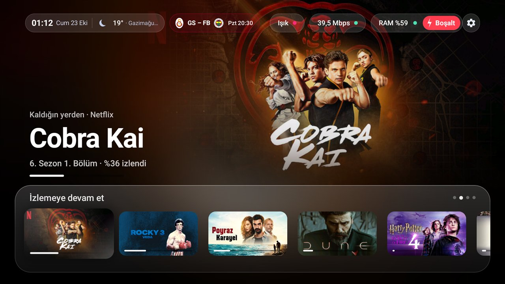
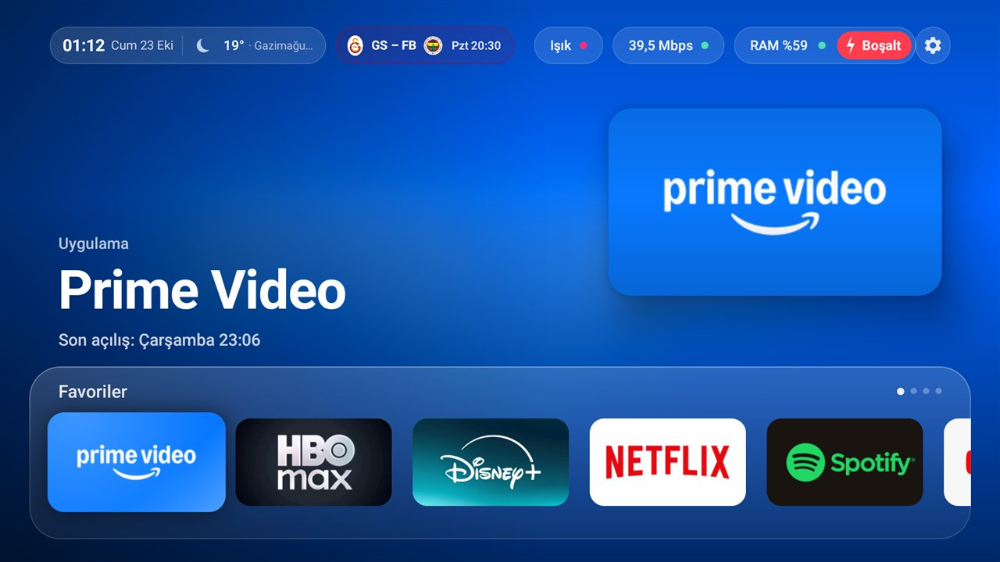
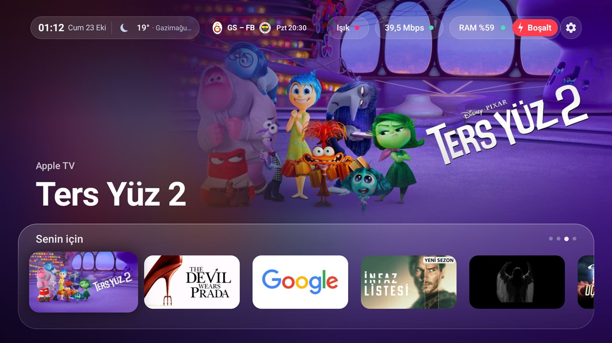
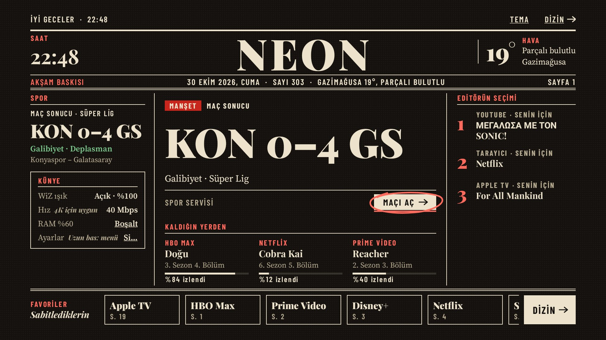
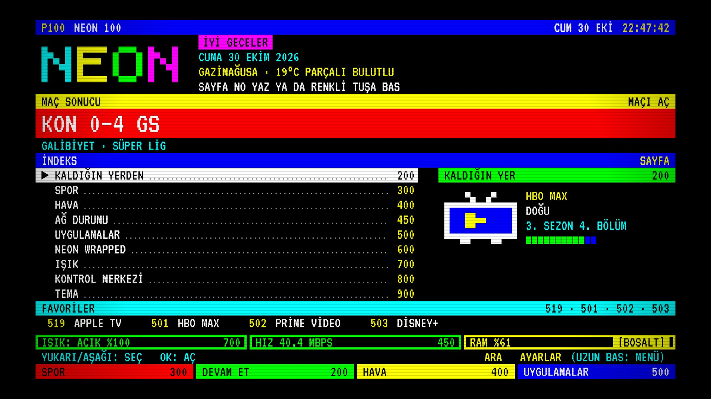
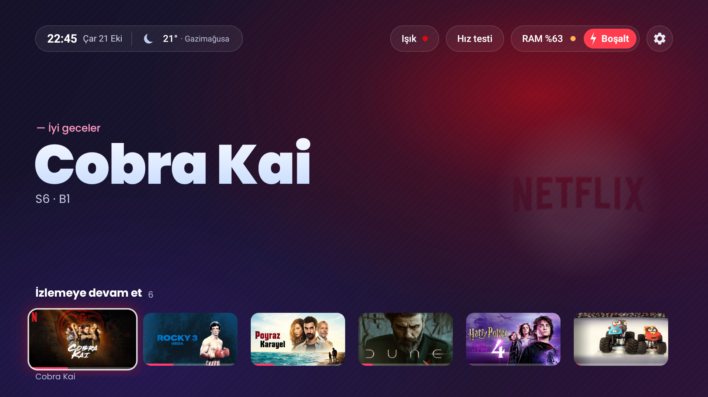
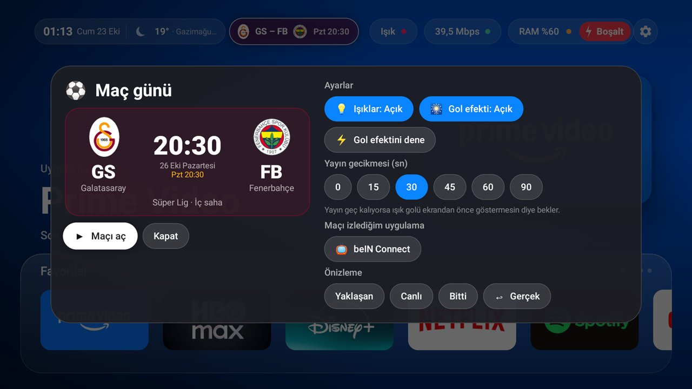
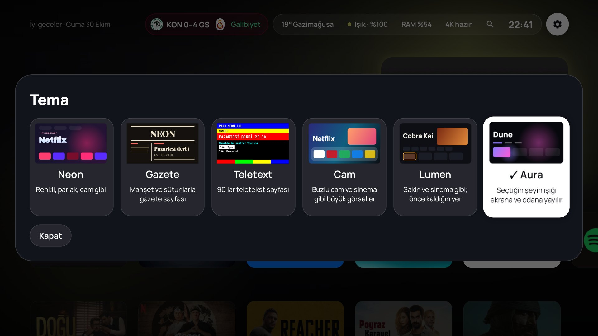

# Serwy Launcher

[](https://github.com/lastcodeb/Serwy-Launcher/actions/workflows/ci.yml)
[](https://github.com/lastcodeb/Serwy-Launcher/releases/latest)

A fast, custom Android TV home screen (app name **Neon**) plus a debloat toolkit, built for the
**Xiaomi Mi TV Box S (2nd Gen)** running Google TV / Android 11. Five themes, live football
match day with WiZ light effects, a monthly "Wrapped" of your viewing, network health, and a
screensaver of real sea-and-sky footage picked by your local time and weather. Everything is set
up from a Windows PC over Wi-Fi ADB. Nothing needs root.

The UI follows the box's language: **Turkish** on a Turkish box, **English** everywhere else.
Code, scripts and docs are in English.



| | |
|---|---|
|  |  |
|  |  |
|  |  |

---

## Contents

1. [Features](#features)
2. [Install a release](#install-a-release)
3. [Tested hardware](#tested-hardware)
4. [Repository layout](#repository-layout)
5. [Requirements](#requirements)
6. [Quick start (build from source)](#quick-start-build-from-source)
7. [Full setup, step by step](#full-setup-step-by-step)
8. [Using the launcher](#using-the-launcher)
9. [Permissions](#permissions)
10. [How it works](#how-it-works)
11. [Languages](#languages)
12. [Performance](#performance)
13. [Development](#development)
14. [Troubleshooting](#troubleshooting)
15. [Known limitations](#known-limitations)
16. [Undo everything](#undo-everything)
17. [Credits and licenses](#credits-and-licenses)

---

## Features

### Themes
Pick one in the control center → *Tema* (Theme). Every theme reskins the whole launcher,
including menus, panels and dialogs.

| Theme | Look |
|---|---|
| **Neon** | The original: gradient titles, glowing glass chips, the hero tinted by the focused app's colors. |
| **Cam** (Glass) | Apple TV-like. The focused show's artwork fills the top of the screen and melts into a frosted blur of itself; app banners float as a lifted tile; a glass shelf holds the rows; cards lift with a spring and catch a light sheen; buttons turn white on focus. |
| **Gazete** (Newspaper) | A front page: masthead, lead story, sports column, editor's picks and an index of every app, set in Playfair Display, Source Serif and Barlow Condensed. Day (paper) and night (ink) editions, switching automatically at sunset. |
| **Teletext** | A 1990s teletext service: page numbers, colored fast-text keys, mosaic graphics, VT323 type, inverse-video focus. Type a page number on remotes that have digits. |
| **Lumen** | Calm and content-first: the focused card's story and artwork in the showcase, the rows below in the Glass order with the active one bright, a quiet top bar (match, weather, light, network, clock). One amber accent, the color of the room's light; cards lift on focus like Glass. A room panel (light, scenes, sleep, system) and a grid of every app. Set in Manrope. |



### Home screen (Neon)
- **Hero** that follows focus: the focused app or episode in a huge gradient title over a faint
  version of the app's real icon, with the whole background glow tinted by the app's colors
  (extracted with Palette from its own banner). Idle for 30 s, it cycles through your favorites.
- **Rows**, one on screen at a time, sliding on a spring:
  - **Favoriler**: apps you pin (smaller cards).
  - **İzlemeye devam et** (continue watching): the system Watch Next list, at most 2 items per
    app, with real thumbnails and progress bars. Opens straight into the episode.
  - **Senin için** (for you): the apps' own recommendation channels, at most 3 per app, mixed
    round-robin.
  - **Tüm uygulamalar** (all apps): every launchable TV app as a 16:9 card with its original
    banner. Long-press to move, hide, favorite, set a light profile or open app info.
- **Top bar**: clock, date and weather (Open-Meteo, no key), WiZ light chip, speed test, RAM usage
  with a one-press "close background apps" button, settings.
- **Control center** (press the clock chip): big clock and weather, light presets, system tools,
  sleep timer, hidden apps, city.
- Pixel-exact layout: the UI is laid out in a fixed 960×540 dp design space (the 1920×1080 design
  at 2×), so it looks identical on any panel density.

### WiZ backlight (WiZ TV Sync Box SYBX-EU-55/65, any WiZ light)
Local UDP control (port 38899), no cloud, discovered automatically.
- On/off, brightness, 8 neon colors, 3 whites, all 32 WiZ scenes, effect speed.
- **Quick access** row with your favorite presets; long-press the bulb chip to toggle Party.
- **Ambient mode**: on the home screen the light takes the focused app's color, and goes back to
  whatever it showed before when you open an app. A light that is off is never switched on.
- **Per-app light profiles**: e.g. Netflix → Film (warm, 30 %), Spotify → Party.
- Effects: a flash in the app's color on launch, a purple "breath" when clearing RAM, a red→green
  gauge during the speed test, a weather-colored light, and a sleep timer that dims then turns
  the light off.

### Match day (Galatasaray)
- A permanent **match chip** in the top bar with both teams' crests and the abbreviations Turkish
  broadcasters use (GS – FB, BJK, TS, İBFK…): the countdown before kickoff, the live score and
  minute, then the result.
- The **match panel**: a scoreboard with large crests, *Maçı aç* (opens the match in the app you
  watch it in, e.g. beIN Connect), settings and a preview of every state.
- **WiZ light effects** in the club's red and yellow: at kickoff, on every Galatasaray goal and
  after a win. A **stream delay** (0–90 s) holds the effects back so the light never spoils a
  goal before the picture shows it.
- Fixtures and live scores come from ESPN's public API (Süper Lig, Champions League, Europa
  League, Conference League); crests are cached on the box.

### Neon Wrapped
A monthly story of your viewing, built from the system's usage history: hours watched, most
watched apps, busiest day and hour, longest session, streaks, a comparison with the previous
month and a "persona" (night owl, weekend marathoner, explorer…). A badge appears when last
month's story is ready.

### Network health
Connection type, Wi-Fi signal, link speed and latency, a history of the last 30 speed tests
(manual and automatic) with the 4K threshold drawn in, and a verdict: *good for 4K*, *enough
for HD* or *weak*. Opening a streaming app on a slow connection shows a warning.

### Screensaver
A real Android `DreamService`: real sea-and-sky footage (Pixabay) chosen by the **actual time of
day and weather** in your city: moonlit sea, sunrise, open sea, sunset, clouds, rain, storm,
fog, snow. Sunrise and sunset times come from Open-Meteo. Hardware-decoded, streamed through a
100 MB cache, 4K whenever the hardware H.264 decoder can handle it. Clock, date and weather on
top; the WiZ light follows the scene and is restored afterwards. When the screensaver ends, the
launcher gives the memory it used back (see [Performance](#performance)).

### Debloat
`debloat.sh` disables (never uninstalls) Xiaomi analytics, ad and recommendation packages and
other unused system apps, lowers animation scales, and swaps the Google TV launcher out.
`restore.sh` undoes all of it.

---

## Install a release

Every [release](https://github.com/lastcodeb/Serwy-Launcher/releases) has a ready-to-install
APK. With ADB connected to the box (see [step 1](#1-enable-adb-on-the-box) and
[step 3](#3-connect)):

```powershell
adb install -r Serwy-Launcher-1.0.0.apk
adb shell appops set dev.mibox.neon GET_USAGE_STATS allow
adb shell pm grant dev.mibox.neon android.permission.READ_TV_LISTINGS
adb shell cmd package set-home-activity dev.mibox.neon/.MainActivity
```

The same APK is published as a Maven package in this repository's
[GitHub Packages](https://github.com/lastcodeb/Serwy-Launcher/packages)
(`dev.mibox:serwy-launcher`, type `apk`).

Release APKs are built **without a Pixabay key**, so the screensaver shows the clock and weather
on a dark background instead of video. To get the footage, build from source with your own free
key (see [step 6](#6-configure-the-build)). Release APKs are signed with a development key;
switching between a release APK and your own build may need an uninstall first.

---

## Tested hardware

| | |
|---|---|
| Box | Xiaomi Mi TV Box S (2nd Gen), model `MiTV-AFKR0`, codename `jaws`, Amlogic SoC |
| OS | Google TV, Android 11 (SDK 30), build `RTT0.211222.001.767` |
| RAM | 2 GB |
| UI | 1920×1080 @ 320 dpi (960×540 dp), HDMI output 2160p60 |
| Light | WiZ TV Sync Box `SYBX-EU-55/65`, module `ESP27_MHORGB_01`, firmware 1.39.1 |
| PC | Windows 11 |

It should work on other Android TV / Google TV devices running Android 11+, but the debloat
package list is specific to this Xiaomi model.

---

## Repository layout

```
.
├── README.md
├── debloat.sh                 # what was applied to the box (disable-only)
├── restore.sh                 # re-enables everything and resets settings
├── device-backup/             # package lists and settings captured before any change
├── docs/screenshots/
├── tv-launcher-design/
│   └── hero-glow.svg          # the 1920×1080 design the home screen follows
├── .github/workflows/         # CI (unit tests + build) and package publishing
└── launcher/                  # the Android app (Gradle, Kotlin, Jetpack Compose for TV)
    ├── install.ps1            # build + install + permissions + set as HOME
    ├── rollback.ps1           # switch HOME back (or to Google TV)
    ├── *_OFL.txt              # font licenses
    └── app/src/
        ├── main/java/dev/mibox/neon/
        │   ├── MainActivity.kt
        │   ├── LauncherViewModel.kt
        │   ├── data/          # apps, prefs, weather, speed test, WiZ, Watch Next, match day,
        │   │                  # usage history (Wrapped), headlines
        │   ├── dream/         # screensaver (DreamService + video)
        │   ├── i18n/          # t(), the English catalog, locale-change receiver
        │   └── ui/            # shared shell, panels and dialogs, the Neon home
        │       ├── glass/     # the Glass (Apple TV-like) home
        │       ├── gazete/    # the newspaper home
        │       └── teletext/  # the teletext home
        └── test/              # JVM unit tests
```

---

## Requirements

**On the PC (Windows)**
- [Android SDK Platform-Tools](https://developer.android.com/tools/releases/platform-tools) (`adb`)
- JDK 17 (e.g. Eclipse Temurin)
- Android SDK command-line tools with `platforms;android-35` and `build-tools;35.0.0`
- Gradle is fetched by the wrapper (or pointed at a local zip, see below)
- Git, and optionally the GitHub CLI

The scripts assume this layout (change the paths at the top of the scripts if yours differs):

```
C:\mibox\platform-tools\adb.exe
C:\mibox\tools\jdk17\
C:\mibox\tools\android-sdk\
C:\mibox\tools\gradle-8.11.1-bin.zip      # optional, used by the wrapper
```

**On the box**
- Developer options and network (USB) debugging enabled
- Same Wi-Fi network as the PC

**Optional**
- A free [Pixabay API key](https://pixabay.com/api/docs/) for the screensaver footage
- A WiZ light with *local communication* allowed in the WiZ app

---

## Quick start (build from source)

```powershell
# 1. Connect to the box (accept the "Allow USB debugging?" prompt on the TV)
C:\mibox\platform-tools\adb.exe connect 192.168.110.31:5555

# 2. Point the build at the SDK and (optionally) the Pixabay key
Set-Content C:\mibox\launcher\local.properties @"
sdk.dir=C\:\\mibox\\tools\\android-sdk
pixabay.apiKey=YOUR_PIXABAY_KEY
"@

# 3. Build, install, grant permissions, make it the default home
powershell -ExecutionPolicy Bypass -File C:\mibox\launcher\install.ps1 -Device 192.168.110.31:5555

# 4. Use it as the screensaver too
C:\mibox\platform-tools\adb.exe shell settings put secure screensaver_components dev.mibox.neon/.dream.NeonDream
```

---

## Full setup, step by step

### 1. Enable ADB on the box

1. **Settings → System → About**, select **Android TV OS build** seven times until it says you
   are a developer.
2. **Settings → System → Developer options**: turn on **USB debugging** (on this box it also
   covers network debugging on port 5555).
3. Note the box's IP: **Settings → Network & Internet → (your Wi-Fi)**.

### 2. Install the PC toolchain

```powershell
# platform-tools
Invoke-WebRequest https://dl.google.com/android/repository/platform-tools-latest-windows.zip -OutFile pt.zip
Expand-Archive pt.zip C:\mibox

# JDK 17 (Temurin), Android command-line tools, Gradle
Invoke-WebRequest "https://api.adoptium.net/v3/binary/latest/17/ga/windows/x64/jdk/hotspot/normal/eclipse" -OutFile jdk.zip
Invoke-WebRequest https://dl.google.com/android/repository/commandlinetools-win-11076708_latest.zip -OutFile clt.zip
Invoke-WebRequest https://services.gradle.org/distributions/gradle-8.11.1-bin.zip -OutFile C:\mibox\tools\gradle-8.11.1-bin.zip
# unzip jdk.zip to C:\mibox\tools\jdk17 and clt.zip's cmdline-tools to
# C:\mibox\tools\android-sdk\cmdline-tools\latest
```

Then, from Git Bash (accepting the licenses needs `yes`):

```bash
export JAVA_HOME=/c/mibox/tools/jdk17
SM=/c/mibox/tools/android-sdk/cmdline-tools/latest/bin/sdkmanager.bat
yes | "$SM" --sdk_root='C:\mibox\tools\android-sdk' --licenses
"$SM" --sdk_root='C:\mibox\tools\android-sdk' "platforms;android-35" "build-tools;35.0.0"
```

The Gradle wrapper in `launcher/gradle/wrapper/gradle-wrapper.properties` points at the local
zip. To let it download Gradle instead, set `distributionUrl` back to
`https\://services.gradle.org/distributions/gradle-8.11.1-bin.zip`.

### 3. Connect

```powershell
C:\mibox\platform-tools\adb.exe connect <BOX_IP>:5555
```

The first time, the TV shows **"Allow USB debugging?"**: tick *Always allow from this computer*
and select **Allow**. If `adb devices` still says `unauthorized`, disconnect and connect again.

### 4. Back up the box (recommended before any change)

```powershell
$adb = "C:\mibox\platform-tools\adb.exe"
& $adb shell pm list packages -f > device-backup\packages_backup.txt
& $adb shell pm list packages -d > device-backup\disabled_packages_backup.txt
& $adb shell "settings get global window_animation_scale; settings get global transition_animation_scale; settings get global animator_duration_scale"
```

This repository already contains the backup taken from the original box in `device-backup/`.

### 5. Debloat (optional)

Read `debloat.sh` first; it only uses `pm disable-user --user 0` (reversible) and:

- disables 24 packages: Xiaomi analytics (`com.miui.tv.analytics`, `com.xiaomi.statistic`), the
  Xiaomi home tabs, channels and Mi TV+, the web-content/ad service, promoted-app auto install,
  the Google TV ambient screensaver, Play Movies, Play Games, feedback, TalkBack, calendar sync,
  print spooler, MIDI, DSU, Hotspot 2.0, the Xiaomi music/gallery/video apps and Miracast;
- sets all three animation scales to 0.5;
- lowers the cached-process limit to 16 (not persistent across reboots, see
  [limitations](#known-limitations));
- disables the Google TV launcher (`launcherx`) **and** the setup wizard (`setupwraith`).

> **Why the setup wizard?** On Google TV, `launcherx` has HOME priority 2 and the setup wizard's
> `RecoveryActivity` has priority 1. Disabling only the launcher leaves you on a "recovery"
> screen. Disabling a single activity needs root, so the whole wizard package is disabled
> (setup is already complete; a factory reset brings it back). Only do this once another
> launcher is installed.

Run it from Git Bash:

```bash
bash debloat.sh 192.168.110.31:5555
```

`debloat.sh` was written while Projectivy was the interim launcher; with Serwy Launcher, run
`install.ps1` before it so a home screen is in place when `launcherx` goes away.

### 6. Configure the build

`launcher/local.properties` (ignored by git, never commit it):

```properties
sdk.dir=C\:\\mibox\\tools\\android-sdk
pixabay.apiKey=YOUR_PIXABAY_KEY
```

Without a Pixabay key everything works; the screensaver just shows the clock on a dark background.
Get a key at <https://pixabay.com/api/docs/> (log in; it is shown in the *key* parameter row).

### 7. Build and install

```powershell
powershell -ExecutionPolicy Bypass -File C:\mibox\launcher\install.ps1 -Device <BOX_IP>:5555
```

`install.ps1`:
1. builds the release APK (R8-minified, signed with the local debug key), wiping the dex folder
   and retrying once if Windows keeps R8's output locked;
2. saves the current HOME activity to `previous_home.txt`;
3. installs the APK;
4. grants the two permissions a launcher cannot ask for itself:
   `appops set dev.mibox.neon GET_USAGE_STATS allow` and
   `pm grant dev.mibox.neon android.permission.READ_TV_LISTINGS`;
5. AOT-compiles the app (`cmd package compile -m speed`) for the fastest cold start;
6. sets it as the default HOME and presses Home.

Add `-SkipBuild` to reinstall the last build. Note that the last step presses **Home** on the
TV, so don't run it while someone is watching.

### 8. Screensaver

```powershell
$adb = "C:\mibox\platform-tools\adb.exe"
& $adb shell settings put secure screensaver_components dev.mibox.neon/.dream.NeonDream
& $adb shell settings put secure screensaver_enabled 1
```

Choose when it starts in **Settings → System → Ambient mode / Screen saver → When to start**.
To preview it right away:

```powershell
& $adb shell service call dreams 6 i32 0 i32 1 s16 dev.mibox.neon s16 dev.mibox.neon.dream.NeonDream
```

### 9. WiZ light

In the WiZ app: **Settings → Security → Allow local communication** must be on. The launcher
discovers the light by broadcasting `getSystemConfig` on UDP 38899 and remembers its IP. Test from
the PC:

```powershell
$c = New-Object System.Net.Sockets.UdpClient; $c.EnableBroadcast = $true
$b = [Text.Encoding]::ASCII.GetBytes('{"method":"getPilot","params":{}}')
[void]$c.Send($b, $b.Length, "<LIGHT_IP>", 38899)
```

---

## Using the launcher

| Where | Press | Does |
|---|---|---|
| Any card | OK | Open the app / resume the episode |
| App card | Long-press OK | Menu: move, hide, add to favorites, light profile, app info |
| Move mode | ◀ ▶ / OK / Back | Move the card / drop it / drop it (works in *Tüm uygulamalar* and in *Favoriler*) |
| Rows | ▲ ▼ | Previous / next row; from the top row, the top bar |
| Watch Next / Senin için card | Long-press OK | Menu: *Favorilere ekle* / *Favorilerden çıkar* (pins the episode to Favoriler) |
| Pinned content card (Favoriler) | OK / long-press OK | Open the episode / menu: *Favorilerden çıkar* |
| Clock chip | OK | Control center (big clock, weather, light, system, network, Neon Wrapped, match day, hidden apps, city) |
| Speed chip | OK / long-press | Run a speed test / *Ağ durumu* panel (link, signal, latency, history) |
| Match chip (Galatasaray) | OK | Match panel: scoreboard, *Maçı aç*, light effects, delay, preview |
| Control center → *Neon Wrapped* | OK | Monthly story: ◀ ▶ pages, ▲ ▼ month, Back closes |
| Light chip | OK / long-press | Light panel / toggle the first quick preset (Party) |
| RAM chip | OK | Close background apps, shows how much was freed |
| Gear | OK / long-press | Android TV settings / launcher menu (hidden apps, city, theme) |
| Control center → *Tema* | OK | Theme picker: Neon, Cam (Glass), Gazete, Teletext, Lumen |
| Home | – | Back to the top row, first card |

The table describes Neon and Glass. Gazete and Teletext lay the same functions out as a
newspaper page and teletext pages (*Tema* / *Dizin* links, page numbers, colored keys); their
footers say which key does what.

**Unhide an app**: Control center → *Gizli uygulamalar*, or long-press the gear → *Gizli
uygulamalar* → select the app.

**Change the weather city**: launcher menu → *Şehir* (Open-Meteo geocoding; default Gazimağusa).

---

## Permissions

| Permission | Why | How it is granted |
|---|---|---|
| `INTERNET` | Weather, speed test, screensaver footage | Install time |
| `KILL_BACKGROUND_PROCESSES` | "Boşalt" button | Install time |
| `QUERY_ALL_PACKAGES` | A launcher must list every app | Install time |
| `READ_EPG_DATA` | TV provider (Watch Next, channels) | Install time |
| `READ_TV_LISTINGS` | Lets the TV provider return other apps' Watch Next and channel rows | `pm grant` in `install.ps1` |
| `PACKAGE_USAGE_STATS` | Last used / recent apps for the hero and showcase | `appops set` in `install.ps1` |

`READ_TV_LISTINGS` is what makes *İzlemeye devam et* and *Senin için* work without root; without
it the provider silently returns only the caller's own rows.

---

## How it works

- **Kotlin + Jetpack Compose for TV** (`androidx.tv:tv-material`), `minSdk 30`, single activity,
  no background services. The only service is the screensaver, which the system runs only while
  dreaming; the sleep timer is an `AlarmManager` broadcast.
- **Design space**: `NeonTheme` overrides `LocalDensity` so 960 dp always spans the screen width;
  texts are placed on the SVG's baselines with a small `baselineAt()` layout modifier.
- **Cheap animation**: focus scale, row slides and background glows are read in the draw /
  graphics-layer phase, so focus changes don't recompose the screen. Cards scale in the graphics
  layer, so neighbours never move.
- **Art**: banners are rendered once on two IO threads to the exact card size, opaque ones in
  RGB_565; Palette gives each app a glow color. Watch Next thumbnails are cropped to the card size.
  When home goes to the background (`TRIM_MEMORY_UI_HIDDEN`) thumbnails and hero logos are
  released.
- **Rows**: navigation between rows is explicit (`RowsController`), each row restores its last
  focused card.
- **WiZ**: JSON over UDP; every command goes through one mutex so effects, ambient color and
  restores never interleave. Ambient snapshots the light on entering home and restores it on
  leaving.
- **Screensaver**: `NeonDream` hosts Compose (it provides its own `LifecycleOwner` and
  `SavedStateRegistryOwner`); `SkyVideos` maps time of day + weather to a mood, searches
  Pixabay (results cached 24 h, tag-filtered, landscape only), ExoPlayer plays them on a
  `SurfaceView` through a 100 MB `SimpleCache`. The dream runs in the launcher's process (a
  separate process crashes `DreamActivity` on Android 11), so a GC shortly after it ends returns
  the ~45 MB of heap it used.
- **Themes**: one `HomeStyle` per theme (colors, fonts, shapes, focus style) is provided at the
  root; the shared panels and dialogs read it, and each theme draws its own home.
- **Glass without blur APIs**: Android 11 has no `RenderEffect`, so the frosted backdrop is the
  artwork shrunk to 64×36, box-blurred three times and stretched with a saturation boost. Fades
  and the poster's soft edges are drawn in a single canvas with a shader mask instead of
  offscreen layers, which halved the theme's GPU memory.
- **Match day**: ESPN's public scoreboard API for fixtures and live scores; an `AlarmManager`
  chain polls only around kickoff, also while another app is in front, to drive the light
  effects.

---

## Languages

The UI is written in Turkish and translated by lookup: `t("Türkçe metin")` returns the Turkish
text on a Turkish box and the entry from the English catalog (`i18n/EnStrings.kt`) on any other
language. Templates use `{0}`, `{1}` placeholders so word order can change
(`"RAM %{0}"` → `"RAM {0}%"`). Dates, day and month names follow the box's locale. When the
system language changes, the launcher restarts itself so everything is rebuilt in the new one.

A unit test fails the build if any `t("…")` in the sources has no English entry, or if a
translation's placeholders differ from the original's. To add a language, add a catalog like
`EnStrings.kt` and pick it in `I18n` by `Locale.getDefault().language`.

---

## Performance

Measured on the box above, launcher in the foreground, Watch Next and recommendations loaded.

| | |
|---|---|
| Cold start (system "Displayed") | 0.43–0.45 s |
| APK size | ~4.5 MB |
| RAM on the home screen (PSS), Neon | ~100–155 MB |
| RAM on the home screen (PSS), Glass | ~145 MB (GPU 55 MB) |
| RAM while another app is in front (PSS) | ~81 MB |
| RAM after a screensaver run | no growth (was +47 MB before the fix) |
| Projectivy Launcher, same box, for comparison | ~87 MB on the home screen |
| Screensaver video decoding | hardware (`OMX.amlogic.avc.decoder`), 3840×2160, ~9 % CPU |

---

## Development

```powershell
cd C:\mibox\launcher
$env:JAVA_HOME = "C:\mibox\tools\jdk17"
.\gradlew.bat testDebugUnitTest      # JVM unit tests (translations, team codes)
.\gradlew.bat assembleRelease        # R8-minified APK in app\build\outputs\apk\release
.\gradlew.bat assembleRelease "-Ppixabay.apiKey="   # a key-free APK, for publishing
```

GitHub Actions runs the unit tests and a build on every push and pull request
(`.github/workflows/ci.yml`). Publishing a release attaches its APK to GitHub Packages
(`.github/workflows/package.yml`). Versions follow [SemVer](https://semver.org/); the tag is
`v<versionName>` from `app/build.gradle.kts`.

---

## Troubleshooting

| Symptom | Fix |
|---|---|
| `adb devices` shows `unauthorized` | Accept the prompt on the TV (tick *Always allow*), then `adb disconnect` and connect again. |
| `error: closed` / `device offline` mid-session | Wi-Fi ADB on this box drops now and then. `adb kill-server`, then `adb connect` again; retry once or twice. |
| Build fails with `FileSystemException ... classes.dex ... being used by another process` | The Gradle daemon (or Defender) holds R8's output. `install.ps1` already kills the daemons and retries; manually: stop `java.exe` processes running `GradleDaemon`, delete `launcher/app/build/intermediates/dex`. |
| A PowerShell call to `install.ps1` never returns when piped | The Gradle daemon inherits the pipe. Run the script directly in a console, or redirect its output to a file. |
| HOME keeps going back to Google TV | `launcherx` (priority 2) wins over any preferred HOME on Google TV; it has to be disabled, see step 5. |
| Stuck on a "setup / recovery" screen after disabling `launcherx` | The setup wizard's `RecoveryActivity` took HOME. `pm enable --user 0 com.google.android.apps.tv.launcherx`, then follow step 5. |
| *İzlemeye devam et* / *Senin için* empty | `READ_TV_LISTINGS` was not granted: `adb shell pm grant dev.mibox.neon android.permission.READ_TV_LISTINGS`. |
| Watch Next item opens an "Open with" chooser | Fixed: the intent is pinned to the publishing app. Update to the latest build. |
| Screensaver screenshots come out white | Expected: the video plays on a hardware overlay that `screencap` cannot capture. Look at the TV. |
| Screensaver shows only a clock | No Pixabay key in `local.properties`, or no internet. |
| Light chip dot grey / "Işık bul" | WiZ local communication is off, or the light is on another network. |
| An app is missing from *Tüm uygulamalar* | It is hidden: Control center → *Gizli uygulamalar*. |

---

## Known limitations

- **Cached-process limit** (`device_config activity_manager max_cached_processes`) resets on
  reboot; persisting it needs root.
- **Closing background apps**: `killBackgroundProcesses` cannot stop an app that is playing
  (foreground service) or visible; `FORCE_STOP_PACKAGES` is a signature permission.
- **WiZ firmware updates** only come through the WiZ app / cloud (`autoUpd` is on).
- **TV-sync brightness** of the WiZ Sync Box is decided by the box itself; the colour channel
  gains in its config (`renderFactor`) are undocumented and left untouched.
- **HDMI output vs. Android display mode**: on Amlogic boxes Android only reports the 1080p UI
  framebuffer (`supportedModes` lists a single 1920×1080 mode) even when HDMI runs at 2160p; the
  real mode only shows in `dumpsys SurfaceFlinger` (`FixedSizeModeMgr:(2160p60hz)`). Pick 4K in
  **Settings → Display & Sound → Resolution**. The screensaver therefore decides on 4K from the
  decoder's capabilities, not from the display mode.
- The debloat list and some UI choices are specific to this Xiaomi model.

---

## Undo everything

```powershell
# Launcher: HOME back to the previous launcher, or to Google TV if it is gone (-Uninstall removes Serwy)
powershell -ExecutionPolicy Bypass -File C:\mibox\launcher\rollback.ps1 -Device <BOX_IP>:5555
```

```bash
# Box: re-enable every disabled package, restore launcher, screensaver and settings
bash restore.sh <BOX_IP>:5555
```

---

## Credits and licenses

- **Design**: `tv-launcher-design/hero-glow.svg`, made with Claude Design.
- **Fonts**, all SIL Open Font License 1.1 (license files in `launcher/`):
  [Poppins](https://fonts.google.com/specimen/Poppins),
  [Playfair Display](https://fonts.google.com/specimen/Playfair+Display),
  [Source Serif 4](https://fonts.google.com/specimen/Source+Serif+4),
  [Barlow Condensed](https://fonts.google.com/specimen/Barlow+Condensed),
  [VT323](https://fonts.google.com/specimen/VT323),
  [Manrope](https://fonts.google.com/specimen/Manrope) (subset to Latin and Turkish). The Glass
  theme uses the system sans (Roboto).
- **Fixtures, live scores and team crests**: ESPN's public API; crests belong to their clubs.
- **Weather, sunrise/sunset, geocoding**: [Open-Meteo](https://open-meteo.com/), data under
  CC BY 4.0.
- **Screensaver footage**: streamed from [Pixabay](https://pixabay.com/) under the Pixabay
  Content License (no attribution required).
- **Watch Next / channels / app banners and icons** belong to their respective apps and are shown
  as published by them on the device.
- WiZ, Xiaomi, Google TV and the app names shown are trademarks of their owners; this project is
  not affiliated with any of them.

Private project, all rights reserved.
